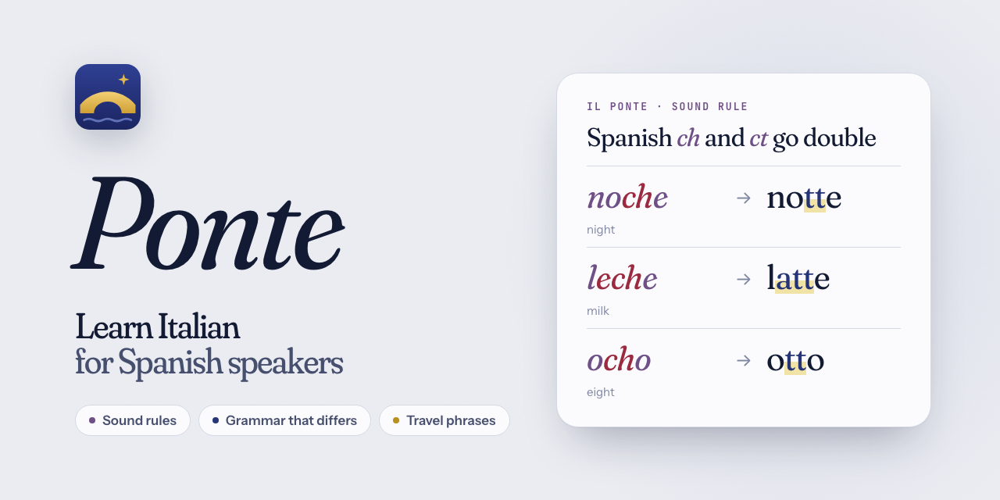
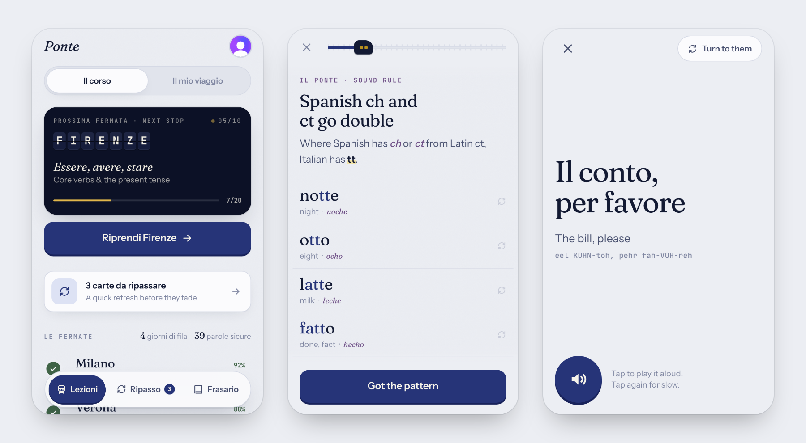
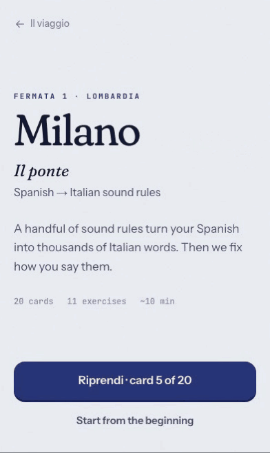
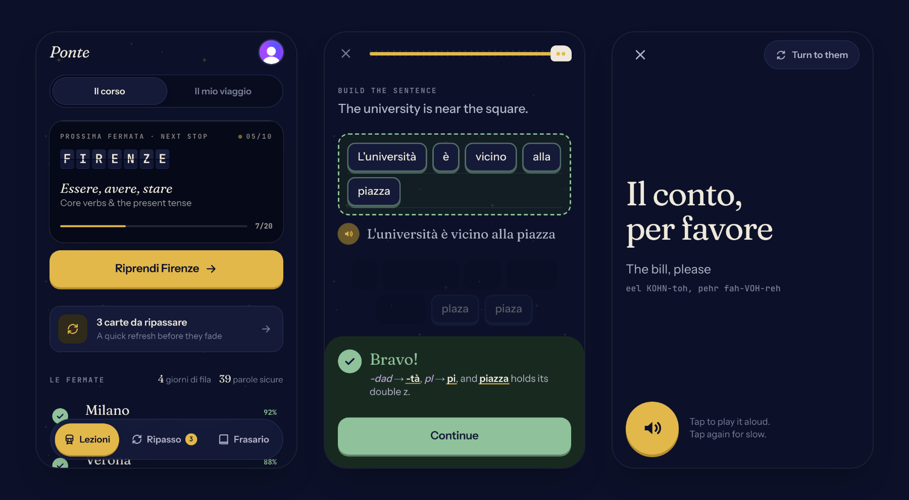

<p align="center">
  
</p>

<p align="center">
  Short Italian lessons for Spanish speakers: the sound rules, the grammar that differs, and the phrases for the trip.
</p>

<p align="center">
  <a href="https://italian.aaronideas.com"><b>Open it → italian.aaronideas.com</b></a>
</p>

I speak Spanish, and I was flying to Italy the next day. A beginner Italian
course starts from zero: colours, numbers, *ciao*. But most of
Italian is already in my head. *Noche* is *notte*, *leche* is *latte*,
*nación* is *nazione*. What I needed was the rules that turn one into the
other, the grammar where the two languages split, and the phrases for a bar,
a station and a hotel desk. So I made that.

Ciao is ten short grammar lessons, seven more for one real route through
Italy, a review deck that schedules itself, and a phrasebook you can hold up
to a waiter. It is a phone-first web app, and your progress survives bad
roaming data.

<p align="center">
  
</p>

## Who it is for

Someone who already speaks Spanish, learns fast, and needs working Italian
soon. It does not teach what you already know. It teaches the difference.

The ten lessons:

| Lesson | What it covers |
| --- | --- |
| Il ponte | Spanish → Italian sound rules |
| Piacere! | Greetings, politeness and *Lei* |
| Il, lo, la, gli… | Articles and plurals |
| Al bar e a tavola | Ordering food and coffee |
| Essere, avere, stare | Core verbs and the present tense |
| Del, nel, al, sul | Prepositions that swallow articles |
| Binario 9 | Trains, directions and time |
| Ho mangiato, sono andato | The past tense |
| Mi piace, ci vado, ne voglio due | Pronouns, *piacere*, *ci* and *ne* |
| Falsi amici | False friends, and how Italians actually talk |

A second line, *Il mio viaggio*, follows one trip from Milano to Venezia:

| Lesson | What it covers |
| --- | --- |
| Si parte! | Landing at Linate, train to Como |
| Sul lago | Boats, a table by the water and a pasta class |
| Cinque paesi | Village trains, a room with no reception, trails and focaccia |
| In cantina | The estate shuttle, a wine tasting and dinner among the vines |
| Viva gli sposi! | A wedding, museums, leather and a dinner for two |
| In macchina e in montagna | Rental car, fuel, tolls, ZTL and rifugi |
| Ultima fermata | Car drop-off, vaporetto, calli and bacari |

Do them in any order. The list suggests a path but does not lock anything.

## How a lesson works

A lesson is about twenty cards, one at a time. There are seven kinds:

| Card | What you do |
| --- | --- |
| **Teach** | Read one to three sentences, with examples you can tap to hear. Depth hides behind a *More* toggle. |
| **Sound rule** | Watch Spanish words turn into Italian, letter by letter. Tap a row to replay it and hear it. |
| **Choice** | Pick one of two to four answers. Keys `1`–`4` work on a keyboard. |
| **Type** | Type a short answer. Case and punctuation do not matter. A missing accent counts as right, with a note. |
| **Build** | Make the Italian sentence from word tiles, with one to three wrong tiles mixed in. |
| **Match** | Pair four or five Italian words with their English meaning. |
| **Listen** | Hear a phrase without seeing it, then pick what it means or what it says. |

`Enter` is always the main button. A card you get wrong comes back at the end
of the lesson until you get it right. Finish a lesson and your ticket gets
stamped *Convalidato*.

<p align="center">
  
</p>

The sound rules are the heart of it. The first lesson has seven:

- *-ción* → *-zione*: nación → nazione, estación → stazione
- *ie* and *ue* flatten: tiempo → tempo, puerta → porta, puente → ponte
- *ch* and *ct* go double: noche → notte, leche → latte, perfecto → perfetto
- *pl*, *ll*, *fl* grow an *i*: plaza → piazza, llave → chiave, flor → fiore
- a silent *h* gets its *f* back: hijo → figlio, harina → farina, hacer → fare
- *j* hides three sounds: ajo → aglio, ojo → occhio, viaje → viaggio
- *-dad* → *-tà*: ciudad → città, verdad → verità

Everywhere in the app, Italian carries a gold highlighter stroke and plays
when you tap it, and Spanish is plum italic, so you always know which language
you are looking at.

## Review and the phrasebook

Every exercise you answer goes into a Leitner deck. A right answer moves the
card up one box, a wrong one sends it back to the first. The boxes are short
on purpose, because the trip is this week: 1 minute, 10 minutes, 1 hour,
8 hours, 1 day, 3 days, 7 days. *Ripasso* gives you up to twelve due cards,
weakest first. When nothing is due, *Practice weakest cards anyway* starts with
your six weakest and fills up with the rest.

The phrasebook is grouped by situation: the bar, the restaurant, the
station, the hotel, emergencies and more. Each phrase has a plain-English
pronunciation (`eel KOHN-toh, pehr fah-VOH-reh`). Star the ones you will need.
*Show someone* puts a phrase full-screen in big type, keeps the screen awake,
and *Turn to them* rotates it 180° so the person across the counter can read
it. Tap any speaker button twice and the second play is at 70% speed.

Search for something the phrasebook doesn't have and it offers to add it. A
model writes the Italian, the meaning, the pronunciation and a tip (through
Vercel AI Gateway), ElevenLabs records it in the same voice as the rest, and
it lands under *Aggiunte* for everyone who uses the app, a few seconds later.
The row shows its progress while it works. Added phrases live in Postgres and
their clips in Vercel Blob, so no deploy is needed.

<p align="center">
  
</p>

## How it works

**Progress is local-first.** A train goes into a tunnel and the app must not
care. Every answer, step and star is an *op* with a client-made id and
timestamp. The op is applied to the in-memory snapshot at once, written to an
outbox in `localStorage`, and sent to the server in batches of up to 200. A
failed send retries after 1, 3, 8, 20, then every 60 seconds. The outbox also
flushes when the network comes back and when the tab is hidden. On load, the
app fetches the server snapshot and replays any unsent ops on top of it.

```
              the phone                                         the server
 ┌──────────────────────────────────┐               ┌────────────────────────────────┐
 │ answer → op { id, at, … }        │               │ POST /api/sync                 │
 │   reduce(snapshot, op), instant  │   batches ─▶  │   validate with zod            │
 │   outbox → localStorage          │    retries    │   apply each op, in order      │
 │                                  │               │   (idempotent by op id)        │
 │ snapshot = server + unsent ops   │   ◀─ on load  │ GET /api/progress?tz=…         │
 └──────────────────────────────────┘               └────────────────┬───────────────┘
                                                                     ▼
                                                               Neon Postgres
                                        answer_log · item_state · lesson_progress · starred_phrase
```

Sending a batch twice is safe. An answer is inserted into `answer_log` with
its op id as the primary key; only a new row moves the card's Leitner box,
and that update runs in SQL with the same intervals the client uses. Lesson
position is newest-timestamp-wins, completion never un-sets, and best accuracy
only goes up. The client runs the same rules in a pure `reduce`, so what you
see offline is what the server will store. Streak days are counted in your
own time zone.

**Audio is pre-generated.** `pnpm audio:gen` collects every Italian string
the app can speak, names each clip by a hash of its text, and asks ElevenLabs
for the missing ones: 64 kbps mono MP3, about 8 KB a second, with a fixed seed
so a re-run sounds the same. It writes the list of keys to
`src/content/audio-manifest.json` and deletes clips no string uses. The app
plays a clip only when its key is in the manifest. For anything else, or when
the file fails to load, it falls back to the device's Italian voice.

**Content is data.** Every lesson and phrase is a typed object in
`src/content/`, with a small inline markup: `«Italian»` (highlighted, tap to
hear), `‹Spanish›`, `~~wrong~~` and `**bold**`. `pnpm content:lint` catches
what TypeScript cannot: unbalanced markup, duplicate ids, options that give
the answer away, build tiles that do not add up, a teach card over three
sentences, three concept cards in a row, a lesson without a Listen, Build,
Match and two Type cards. `pnpm audio:check` fails when a speakable string
has no clip.

**The content is also the answer key.** The Playwright test signs in a Clerk
test user, takes every lesson from start to finish, and answers each card
from the lesson data: the option index for Choice and Listen, the first
accepted answer for Type, the tiles in order for Build, every pair for Match.
Then it waits until the server reports the lesson complete. A broken card,
a broken exercise or a broken sync fails the run.

## Stack

- [Next.js 16](https://nextjs.org) App Router with Cache Components, React 19
- [Tailwind CSS v4](https://tailwindcss.com) and [Motion](https://motion.dev)
- [Clerk](https://clerk.com) for sign-in
- [Neon](https://neon.tech) Postgres through [Drizzle ORM](https://orm.drizzle.team) and the Neon HTTP driver
- [Zod](https://zod.dev) for the sync payload
- [ElevenLabs](https://elevenlabs.io) for the audio, at build time only
- Vitest and Playwright
- Deployed on Vercel

## Run it locally

```bash
pnpm install
pnpm db:migrate     # creates the five tables
pnpm dev
```

Then open http://localhost:3000 and sign in.

| Variable | Where | What for |
| --- | --- | --- |
| `DATABASE_URL` | `.env.local` | Neon connection string |
| `DATABASE_URL_UNPOOLED` | `.env.local` | Optional. Direct connection for `db:migrate`; falls back to `DATABASE_URL` |
| `NEXT_PUBLIC_CLERK_PUBLISHABLE_KEY` | `.env.local` | Clerk dashboard → API keys |
| `CLERK_SECRET_KEY` | `.env.local` | Same place. The E2E test also uses it to make its test user |
| `APP_URL` | env | Optional. Base URL for Open Graph links; defaults to the live site |
| `ELEVENLABS_API_KEY` | `.env`, Vercel | `pnpm audio:gen`, and on the server to record added phrases. Without it, added phrases use the device voice |
| `BLOB_READ_WRITE_TOKEN` | Vercel Blob integration | Stores the clips of added phrases |
| `VERCEL_OIDC_TOKEN` | automatic on Vercel; `vercel env pull` locally | Pays for AI Gateway, which writes added phrases. Claude models need paid gateway credits; until then it falls back to a free model |
| `PHRASE_MODEL` | env | Optional. Gateway model for added phrases; defaults to `anthropic/claude-sonnet-5.5` |

The audio is committed in `public/audio/`, so you do not need an ElevenLabs
key to run the app.

## Scripts

| Command | What it does |
| --- | --- |
| `pnpm test` | Vitest: answer grading, the letter diff behind the sound-rule animation, the Leitner boxes |
| `pnpm e2e` | Playwright: every lesson, start to finish, all answers right. Uses a dev server on port 3311 and starts one if none is running |
| `pnpm content:lint` | Static checks on all course content |
| `pnpm audio:check` | Fails if any speakable string has no clip, or a clip has no string |
| `pnpm audio:gen` | Generates missing clips (`--dry-run` to only count characters) |
| `pnpm db:generate` / `pnpm db:migrate` | Drizzle migrations |
| `pnpm lint` / `pnpm typecheck` | ESLint and TypeScript |
| `pnpm brand` | Re-renders the banner, the Open Graph image and every icon from `assets/brand/` |
| `pnpm screenshots` | Re-takes the pictures in this README from the running dev server |

CI runs lint, typecheck, the unit tests, the content linter and the audio
check on every push to `main` and every pull request.

## Credits

Italian voice: "Violetta" from the [ElevenLabs](https://elevenlabs.io) voice
library.

Set in [Fraunces](https://github.com/undercasetype/Fraunces),
[Instrument Sans](https://github.com/Instrument/instrument-sans) and
[JetBrains Mono](https://github.com/JetBrains/JetBrainsMono), all under the
SIL Open Font License. Copies of the fonts and their licences are in
`assets/brand/fonts/`.

The colours come from fresco: lime plaster, the lapis blue of Giotto's
Scrovegni Chapel vault, cypress green, Chianti red, plum and gold leaf.

## License

MIT. See [LICENSE](LICENSE).
